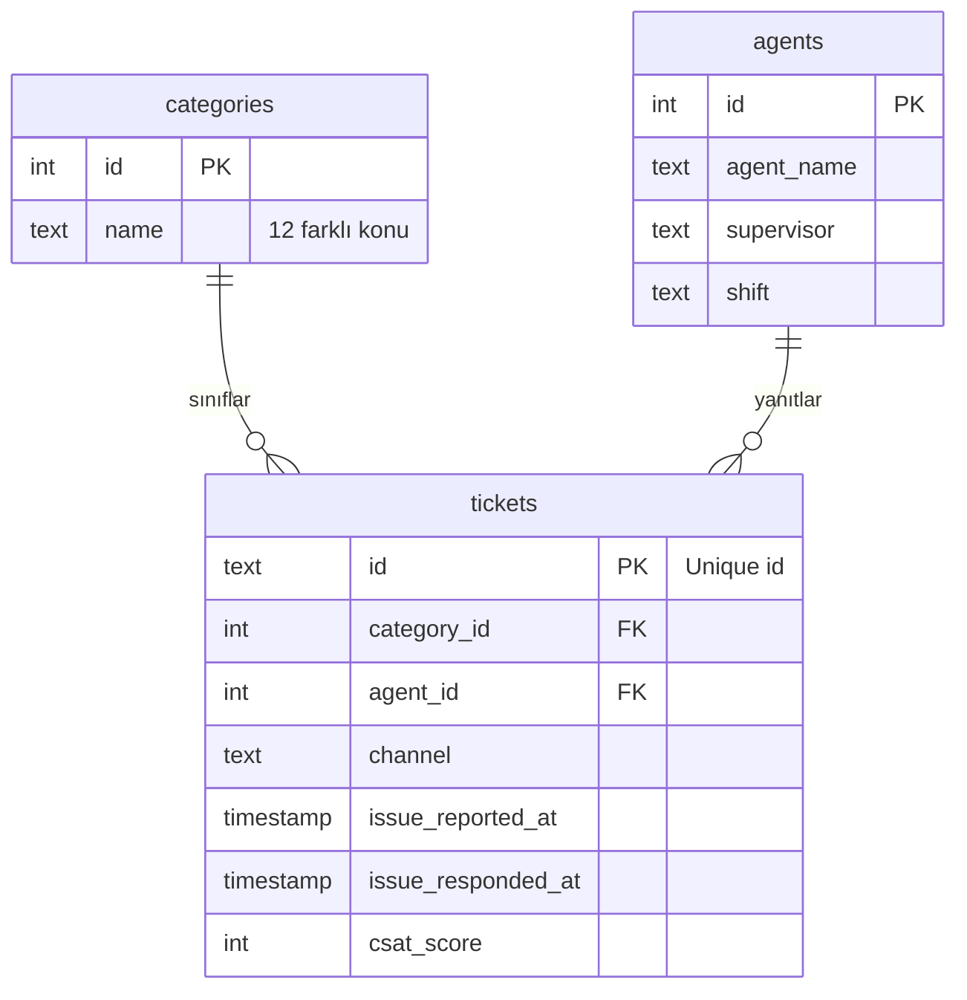

# Ödev 2 - Kendi Projem: Müşteri Hizmetleri Talepleri (Kura #42)

## 2.1 Güncel ERD

## 2.2 Normalizasyon notu
- Kaggle verisinde her satır bir talep ve her satırda kategori adı, temsilci adı ve süpervizör tekrar ediyor.
- Süpervizör talebe değil temsilciye bağlı (talep → temsilci → süpervizör). Bu dolaylı bağımlılık 3NF'e aykırı; bir temsilcinin süpervizörü değişirse binlerce satırı güncellemem gerekirdi.
- Bu yüzden `agents` ve `categories` tablolarını ayırdım, `tickets` bunlara id ile bağlanıyor. Her bilgi artık tek bir yerde.
- Vizede planladığım `messages` tablosunu çıkardım çünkü verimde mesaj düzeyinde kayıt yok. Mesaj sayısı yerine yanıt süresini (`issue_responded_at - issue_reported_at`) kullanıyorum.